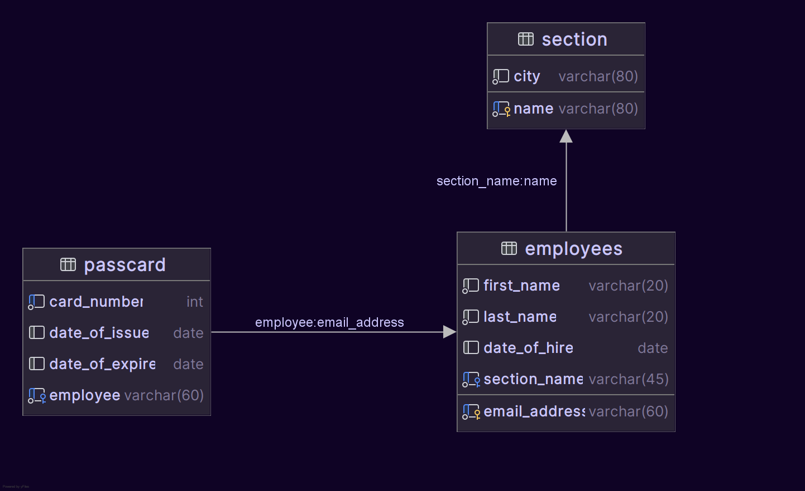
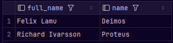
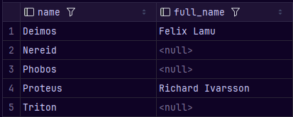
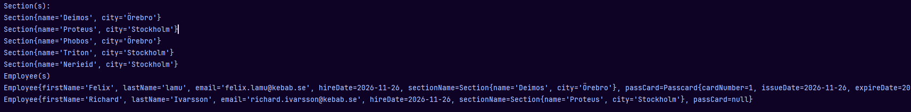

## Databas lab 2 - Felix Lamu

### Verksamhetsbeskrivning: 

- Personal 

Information om de anställda inom företaget.

- Avdelgning

Information om de olika lokaler samt lokalsort som företaget använder

- Passerkort

Information om passerkort samt vilken anställd det tillhör.

___
## Attribut 

#### Avdelning
[create_table.sql](src/main/java/create_table.sql)

    section

        name, sträng som inte är null, begränsad till 80 chars
        city, sträng som inte är null, begränsad till 80 chars
        Primär nyckel är name


#### Personal

    employees

        first name, sträng som inte är null, begränsad till 20 chars
        last name, sträng som inte är null, begränsad till 20 chars
        email address, sträng som inte är null, begränsad till 60 chars, är unik
        date of hire, datum
        section name, sträng som inte är null, begränsad till 45 chars,
        främmande nyckel, section name refererar till namnet av en avdelning.
        Primär nyckel är email address
    

#### Passerkort

    passcard
        card number, int, automatisk ökning, unik
        date of issue, datum
        date of expire, datum
        employee, sträng, primär nyckel
        främmande nyckel, employee, refererar till anställd personals email address.

___
### Relationer

#### Avdelning -> Personal - En till Många.

En avdelning kan bestå av inga anställda eller många anställda, däremot måste en anställd tillhöra
en avdelning.

Detta gör vi genom att ge employees tabellen en främmande nyckel som refererar till en avdelnings namn
vilket sedan sätts som ett attribut i tabellen med VARCHAR(80) och NOT NULL vilket gör så att section namnet 
måste anges för att en anställd ska kunnas regristera in till systemet.

--
#### passerkort -> personal - En till En.

Ett passerkort måste ha en koppling till en anställd men alla anställda behöver inte ha ett passerkort.
passerkortet får även bara kopplas till en enskild anställd.

Detta gör vi genom att koppla passerkortet till en anställd med deras email address som används som primär nyckel
för anställda och är unik. det kommer inte finnas någon annan anställd med likadan email som en annan.
koppligen får även inte vara tom.

___
### Diagram



---

### SQL join queries
[insert_table.sql](src/main/java/insert_table.sql) - File where the SQL for inserting data into tables are done

[join_data.sql](src/main/java/join_data.sql) - File where the SQL for join queries are done
### Inner Join

```sql

SELECT concat(e.first_name, ' ', e.last_name) AS full_name, s.name
FROM employees as e
INNER JOIN section AS s ON e.section_name = s.name;
```
#### Result 




### Left Join

```sql
SELECT s.name, concat(e.first_name, ' ', e.last_name ) AS full_name
FROM section AS s
         LEFT JOIN employee AS e ON e.section = s.name;
```

#### Result


___
## Java
Inom fil strukturen finns [Main.java](src/main/java/se.iths.felix.lab2/Main.java) samt ett [Model](src/main/java/se.iths.felix.lab2/model).

Model foldern håller java representanterna av tabellerna.

### [Employee.java](src/main/java/se.iths.felix.lab2/model/Employee.java)
Employee java håller all data som respektive tabel employee håller. Genom att skapa privata final value för varje
attribute som finns inom tabellen så har jag lagt plats till att data'n ska kunna hämtas och lagras som ett Employee objekt.

Varje värde kan icke vara null samt så kallas section till konstruktorn där man plockar ut namnet från sectionen.

### [Section.java](src/main/java/se.iths.felix.lab2/model/Section.java)

Section java håller section namn och ort båda kan icke vara null. Detta motsvarar vad section tabellen håller.

### [Passcard.java](src/main/java/se.iths.felix.lab2/model/Passcard.java)

Passcard java håller kort nummer, datum då passkortet gavs ut samt vilket datum det går ut. Samma krav som passkort tabellen har.

### [Main.java](src/main/java/se.iths.felix.lab2/Main.java)

I Main.java skapa vi upp varje class objekt samt skapar vi objekt som lagrar datan av två exempel anställda och flera sektioner
som representerar test datan vi har i tabellerna. sedan skapar vi listor med sektionerna och de anställda och använder for loops för att skriva
ut all data.



